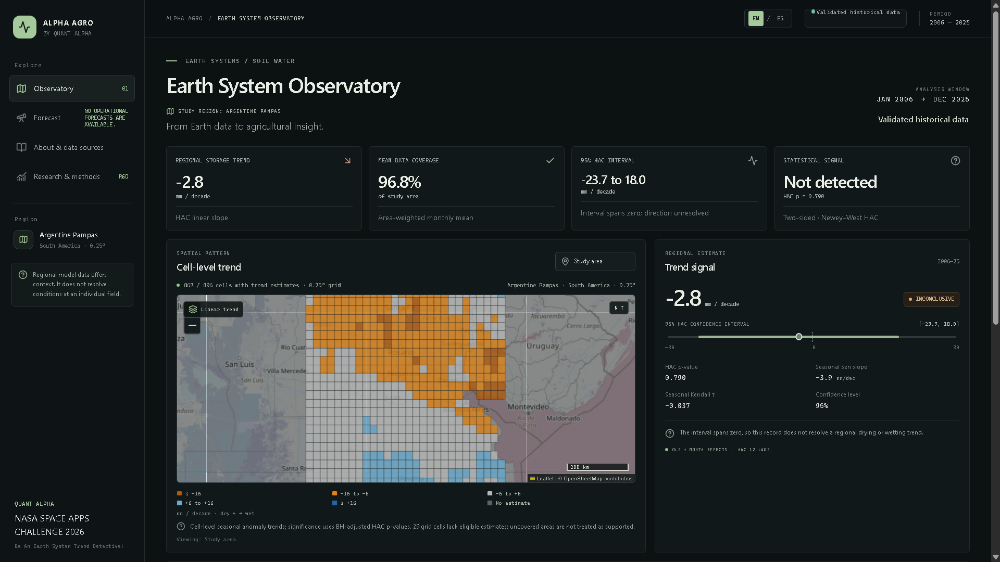
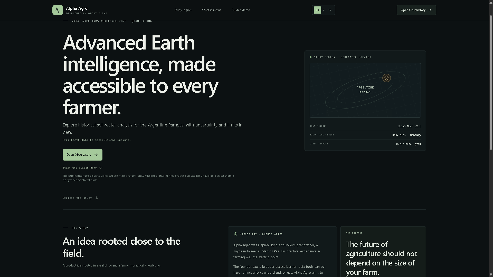
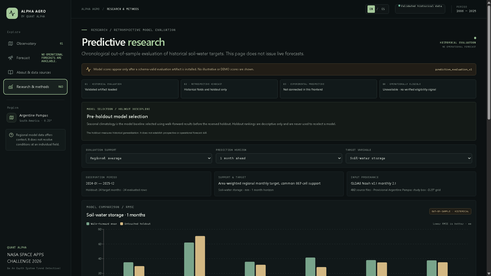
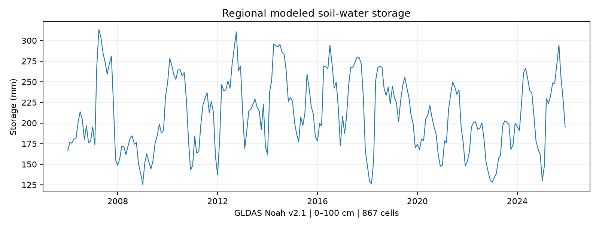
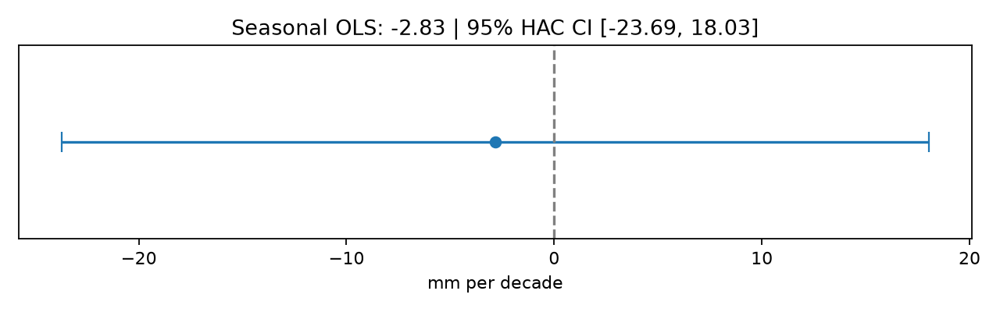
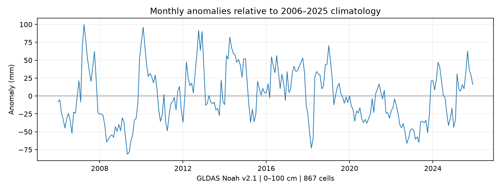
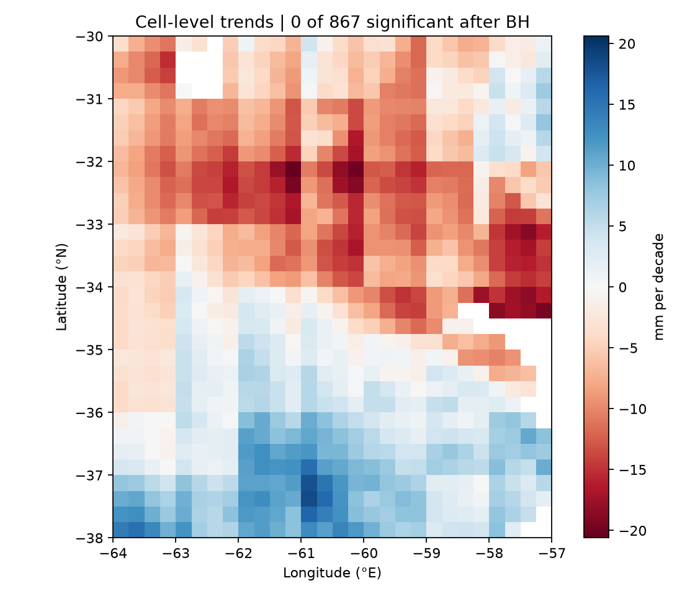
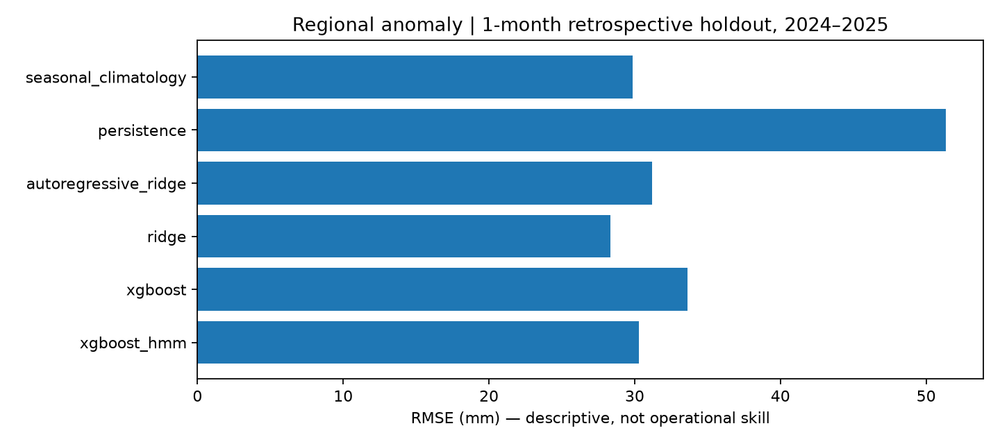

# Alpha Agro | Earth system intelligence for agriculture

[](https://github.com/santiago-pascual/quant-alpha-agro/actions/workflows/portfolio-ci.yml)

Independent scientific computing project by **Santiago Pascual**, developed as a solo participant in the 2026 NASA Space Apps Challenge, [Be An Earth System Trend Detective!](https://www.spaceappschallenge.org/2026/challenges/earth-system-trend-detective/). Alpha Agro combines NASA land-surface-model data, reproducible statistical inference, retrospective predictive evaluation and an interactive Earth-system observatory for the Argentine Pampas.

**Research question:** Has modeled soil-water storage in the upper metre changed over 2006–2025, and can historical hydrological information improve on seasonal-climatology forecasts?

## Application

The React/TypeScript application includes an Observatory (regional time series, anomalies and cell trends), Forecast workspace (saved locations and experimental outlook), Research & Methods (retrospective model comparisons), and About & Data Sources. English and Spanish are supported. Agricultural context is exploratory; it is not field-level advice. The repository includes five approved public JSON artifacts, so the historical demonstration does not require an Earthdata credential. The following screenshots were captured from the locally running production build on 25 November 2026.







Additional application views: [field selection](docs/figures/portfolio/forecast_location.png) and [experimental field outlook](docs/figures/portfolio/forecast_explorer.png). The outlook is not an operational forecast.

## Data and provenance

| Product | Role |
|---|---|
| [GLDAS Noah v2.1 monthly, 0.25°](https://doi.org/10.5067/SXAVCZFAQLNO) | Core modeled 0–100 cm soil-water storage; 240 monthly records |
| GLDAS Noah v2.1 three-hourly | Cadence and units verification sample |
| MOD17A3HGF annual NPP and Argentine agricultural estimates | Exploratory vegetation and provincial yield context, not predictions |
| GPM IMERG, MOD13Q1 and SMAP | Candidate comparison products / separate research tracks; not inputs to the core trend result |

The provisional study box is 64–57°W, 38–30°S, not an official Pampas boundary or crop mask. Storage sums three GLDAS layers (0–10, 10–40 and 40–100 cm); kg/m² is numerically equivalent to mm water equivalent. See [data inventory](docs/PHASE_1_DATA_INVENTORY.md), [monthly checksums](docs/GLDAS_MONTHLY_SHA256.csv) and [data manifest](docs/DATA_MANIFEST.md). Raw NetCDF exports are not distributed in this checkout.

## Methodology and historical findings

The engine validates granules, units, time bounds and masks; computes spherical-area-weighted regional means; subtracts calendar-month climatologies; fits OLS with calendar-month fixed effects and 12-lag Newey–West HAC covariance; and evaluates cell-level slopes with Benjamini–Hochberg correction. Seasonal Sen and Kendall estimates are complementary descriptive diagnostics. See [trend engine](docs/TREND_ENGINE.md) and [real-data report](docs/REAL_DATA_RESULTS.md).

| Result | Value |
|---|---:|
| Period | Jan 2006–Dec 2025 (240 months) |
| Common valid grid | 867/896 cells (96.76% of grid cells) |
| Regional slope | −2.83 mm/decade |
| 95% HAC interval | [−23.69, +18.03] mm/decade |
| HAC p-value | 0.790 |
| Seasonal Sen slope | −3.93 mm/decade |
| Cell slopes | 517 negative, 350 positive |
| Cells significant after BH at 0.05 | 0 |

The direction of the regional trend remains unresolved. A negative point estimate is not evidence of statistically significant drying. The offline portfolio check independently reproduces the regional slope and HAC interval from the exported series and checks spatial aggregation and manifest consistency; it does not re-download or revalidate raw NetCDF files.






## Predictive research: baselines before complexity

The committed retrospective evaluation compares six model families (seasonal climatology, persistence, autoregressive ridge, ridge, XGBoost and XGBoost with forward-filtered HMM features) across regional and spatial targets, three monthly horizons and three target definitions. Expanding walk-forward selection precedes the reserved January 2024–December 2025 holdout. Training-only preprocessing and issue-time availability cutoffs are documented in [predictive results](docs/PREDICTIVE_REAL_DATA_RESULTS.md).

All 18 recorded pre-holdout selections favor seasonal climatology. For the regional one-month anomaly target, the selected baseline has holdout RMSE 29.84 mm; ridge has 28.36 mm descriptively, and persistence 51.36 mm. Holdout ranking is not a new model-selection rule. Archived final products use an assumed five-month release lag, not verified historical release snapshots. The holdout is only 24 months; spatial cells are not independent time replicates. These scores were checked against the committed evaluation artifact, not independently refitted.



The separate Phase 8 bundle is explicitly experimental (`operationally_eligible: false`). Operational forecast and spatial hindcast artifacts are absent; the application must withhold unsupported values. No crop-damage, yield or irrigation recommendations follow from these experiments.

## Architecture and stack

```text
NASA Earthdata / local NetCDF → gldas acquisition + validation
                              → trend / relationship / predictive research
                              → versioned JSON artifacts
                              → React + TypeScript + Vite static application
```

Python, NumPy, pandas, SciPy, netCDF4, scikit-learn and optional XGBoost support research; React, Leaflet and Recharts support the interface. `gldas/` contains acquisition, validation, trend, availability and predictive modules; `config/` contains contracts; `tests/` contains Python tests; `frontend/` contains UI, adapters and tests; `docs/` contains research evidence and provenance.

## Reproduce and run

See [setup and verification](docs/PORTFOLIO_REPRODUCTION.md) for environment, Earthdata authentication, offline artifact checks and full research commands. Quick frontend demonstration (Node.js 22, locally tested):

```sh
cd frontend
npm ci
npm run dev
```

Offline artifact verification and figure generation (NumPy and matplotlib required):

```sh
python scripts/portfolio_evidence.py
```

## Testing and validation

Local Windows verification: 119 Python tests and four subtests passed; all 117 frontend tests across 22 suites passed using Node.js 22; TypeScript compilation, production build and offline artifact verification passed. Scientific JSON files are checked out with LF line endings to preserve provenance hashes. See [portfolio audit](docs/PORTFOLIO_AUDIT.md) for executed checks and remaining blockers. The existing [manual Pages workflow](.github/workflows/deploy-alpha-agro.yml) checks public artifacts, TypeScript, frontend tests and build before deployment. A separate [CI workflow](.github/workflows/portfolio-ci.yml) is provided for non-deploying frontend and artifact checks; the workflow has passed on GitHub Actions.

## Scientific limitations

GLDAS is modeled hydrology, not direct field measurements. The region is provisional; no independent in situ validation or causal attribution is established. The retrospective full-period anomaly climatology must not be reused as a forecast feature without training-only fitting. Spatial dependence limits multiplicity interpretation; release-lag assumptions limit predictive conclusions. Agricultural and experimental outlook panels do not establish operational forecast skill, crop stress, yield, damage or field-specific recommendations.

## Author and acknowledgments

Santiago Pascual — independent solo developer and research participant. Acknowledgment to NASA GES DISC and the GLDAS data providers, NASA Space Apps Challenge organizers, and the open-source scientific and mapping communities. This project does not imply NASA employment, endorsement, sponsorship or an award.
