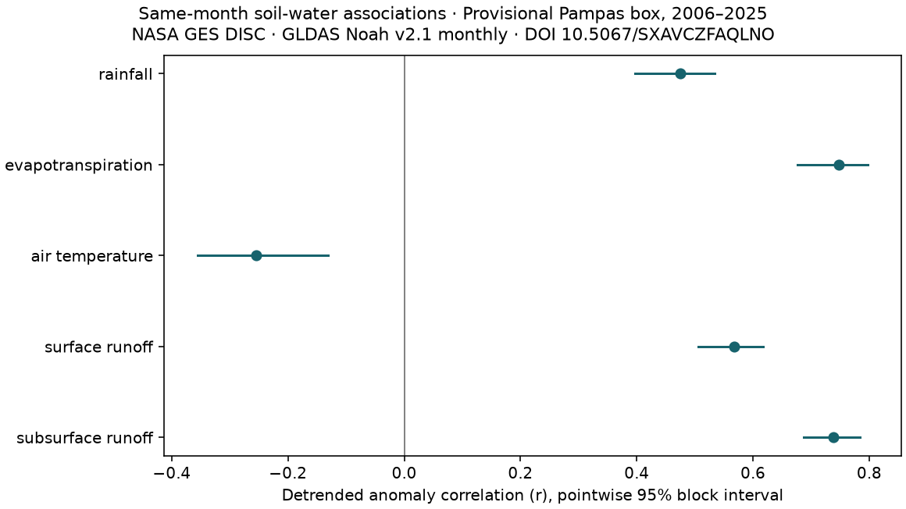
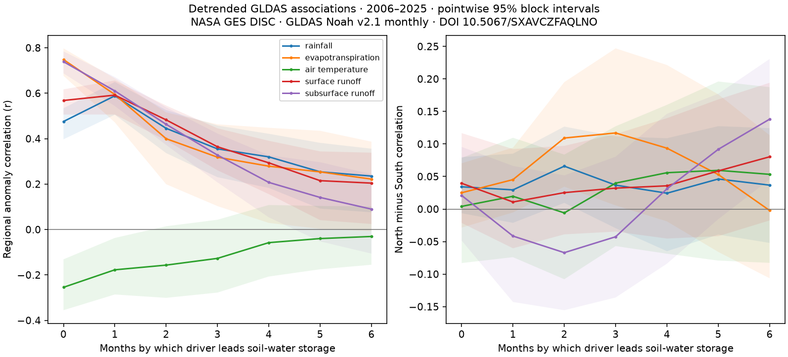

# Earth system relationships in the provisional Pampas box

The analysis pairs modeled 0–100 cm soil-water storage with total precipitation forcing, evapotranspiration, near-surface air temperature, and surface and subsurface runoff in NASA GLDAS Noah v2.1. The series share model physics and meteorological forcing. An association can be consistent with a physical mechanism without independently validating it or establishing causation. The box and 0.25° cells represent regional conditions. [Data validation](MULTIVARIABLE_DATA_VALIDATION.md)

## Method

For each regional series, remove calendar-month fixed effects and a linear time trend over the 2006–2025 record. Compute Pearson correlations for prespecified leads of 0–6 months, positive when the driver leads soil-water storage. Treat the analysis as retrospective because the adjustment uses the full record. The north and south split is fixed at 34°S. Resample aligned chronological pairs with 1,999 seeded 24-month circular moving blocks. Use identical resamples in each half-box to preserve shared temporal variation when estimating north-minus-south differences. Intervals are pointwise 95% and conditional on the fitted seasonal adjustments. Report 12-lag HAC p-values for standardized slopes, with a single Benjamini–Hochberg adjustment across five variables, seven lags and three regions (105 associations). The correction is approximate for dependent tests. Contrast intervals are exploratory and unadjusted.

The forecast comparison uses a fixed training period of January 2006–December 2020. It predicts the target month's departure from the training-only monthly climatology. All models use only measurements at least five calendar months before the target, leaving four complete intervening months for nominal main-stream publication. Exclude the first four target months of 2021 so the last training month is no later than the first holdout input cutoff. Fit all coefficients on training pairs and keep them fixed for May 2021–December 2025. Compare seasonal climatology, anomaly persistence, one lagged soil-water term, and the same term with lagged precipitation and temperature. The holdout approximates reporting delays but uses archived final products. The original release-time snapshots are unavailable, so the comparison cannot establish live forecast skill. Paired RMSE intervals use a 24-month block and a 56-month test series, which limits precision. [NASA product description and latency](https://data.nasa.gov/dataset/gldas-noah-land-surface-model-l4-monthly-0-25-x-0-25-degree-v2-1-gldas-noah025-m-at-ges-di-23acd)

## Observed associations

All 240 months passed validation. The joint mask was constant, covering 96.76% of study-box area, 97.96% of northern area, and 95.50% of southern area.

| Driver | Same-month correlation (240 pairs) | 95% block interval |
| --- | ---: | ---: |
| Total precipitation forcing | +0.475 | [+0.397, +0.534] |
| Evapotranspiration | +0.748 | [+0.677, +0.798] |
| Near-surface air temperature | −0.255 | [−0.355, −0.131] |
| Surface runoff | +0.568 | [+0.506, +0.617] |
| Subsurface runoff | +0.739 | [+0.687, +0.784] |

Precipitation one month earlier correlated at **+0.589** with soil-water storage (95% block interval +0.505 to +0.650, 239 pairs). Earlier temperature correlated at −0.178 (−0.286 to −0.037, 239 pairs) at the same lead. These are bivariate associations. Soil-water persistence and shared forcing can produce associations at multiple leads. Positive evapotranspiration and runoff correlations can reflect greater water availability even though both fluxes remove water from storage. All five same-month north-minus-south intervals span zero. The lagged contrasts are exploratory.

## Held-out baseline comparison

| Baseline | RMSE (mm) | MAE (mm) | 95% interval for RMSE difference vs persistence (mm) |
| --- | ---: | ---: | ---: |
| Seasonal climatology | 37.10 | 31.46 | [−16.82, +17.33] |
| Persistence | 37.93 | 30.15 | [0, 0] |
| Autoregression | 33.88 | 29.67 | [−14.83, +9.84] |
| Autoregression with precipitation and temperature | 33.41 | 29.28 | [−15.70, +9.51] |

The environmental baseline reduced point-estimate RMSE by 4.51 mm versus persistence and 0.47 mm versus autoregression. The interval versus persistence spans zero. This comparison does not establish that the environmental model improves on persistence.

## Space Apps presentation

- The team validated 20 years of NASA monthly data for five additional Earth system variables.
- In GLDAS, wetter-than-usual months tended to follow wetter-than-usual precipitation months. A shared model and forcing limit the interpretation.
- The long-term regional soil-water trend remains unresolved. The retrospective forecast comparison does not support a validated operational forecast.

Run the [documented workflow](MULTIVARIABLE_DATA_VALIDATION.md#reproduction) to regenerate the figures, full results, monthly aligned series, and acquisition manifest under `data/analysis/multivariable/`. [Machine-readable results](GLDAS_RELATIONSHIPS_RESULTS.json) · [Driver export checksums](GLDAS_DRIVER_SHA256.csv)
