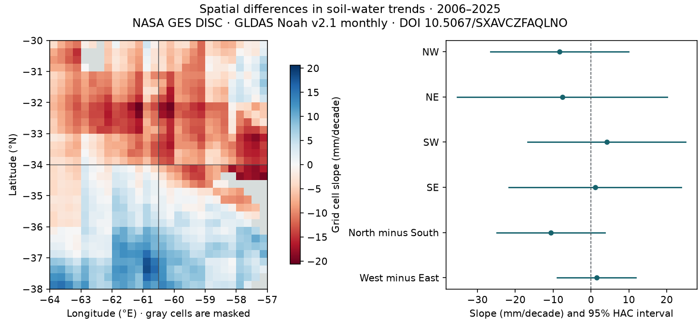
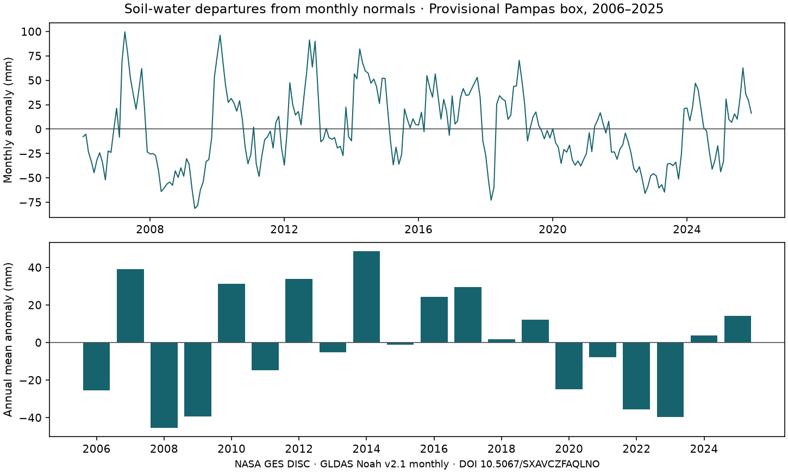

# What changed across the Pampas study box?

The 2006–2025 NASA GLDAS record shows persistent wet and dry departures and different trend estimates across the study box. **The direction of the long-term regional trend remains unresolved.** This analysis covers 0–100 cm modeled soil-water storage within a provisional rectangle (38–30°S, 64–57°W), with the same 867 of 896 cells contributing each month (96.76% of grid area). [First analysis](REAL_DATA_RESULTS.md) · [Input checksums](GLDAS_MONTHLY_SHA256.csv) · [NASA product](https://doi.org/10.5067/SXAVCZFAQLNO)

## Robustness

Estimates use calendar-month fixed effects and a 12-month HAC bandwidth unless specified. Intervals are pointwise 95% and slopes are in mm/decade. The windows were chosen by calendar position before computing their results. The cases share data and should not be counted as independent tests. [Design](SCIENTIFIC_DISCOVERY_DESIGN.md) · [Newey–West covariance](https://www.nber.org/papers/t0055)

| Case | Months | Slope | 95% interval |
| --- | ---: | ---: | ---: |
| Full record, 2006–2025 | 240 | −2.83 | [−23.69, +18.03] |
| First half, 2006–2015 | 120 | +40.18 | [−13.19, +93.55] |
| Second half, 2016–2025 | 120 | −36.31 | [−81.90, +9.28] |
| Centered window, 2009–2023 | 180 | −21.97 | [−54.65, +10.70] |
| Full record, 6 HAC lags | 240 | −2.83 | [−21.99, +16.32] |
| Full record, 24 HAC lags | 240 | −2.83 | [−22.37, +16.71] |
| Equal cell weights | 240 | −2.68 | [−23.52, +18.16] |
| Interior box (37–31°S, 63–58°W) | 240 | −4.09 | [−26.24, +18.06] |
| Require 95% coverage | 240 | −2.83 | [−23.69, +18.03] |
| Require 98% coverage | 0 | — | — |
| Omit 12 largest absolute anomalies | 228 | +0.51 | [−18.15, +19.18] |
| Seasonal Sen, block-bootstrap interval | 240 | −3.93 | [−23.75, +15.56] |

The primary p-value is 0.790. No estimable regional interval excludes zero. Opposite point estimates in the fixed halves describe window sensitivity and do not establish a trend reversal. Omitting extreme months is an influence check using the outcome itself. The resulting interval is conditional on those omissions. The 98% threshold excludes all months under a constant missing mask. Seasonal Sen uncertainty uses 1,999 circular moving-block resamples of fitted residuals, with 24-month blocks aligned to January, and assumes a sufficiently stable, weakly dependent residual process.

## Spatial differences



The quadrants are fixed by cell centers at 34°S and 60.5°W. The comparisons fit differences between the area-weighted half-box series, preserving simultaneous variability. All six estimates use 240 months.

| Area or contrast | Supported cells | Area coverage | Slope (mm/decade) | 95% HAC interval |
| --- | ---: | ---: | ---: | ---: |
| Northwest | 215/224 | 95.92% | −8.33 | [−26.58, +9.91] |
| Northeast | 224/224 | 100% | −7.58 | [−35.32, +20.16] |
| Southwest | 224/224 | 100% | +4.14 | [−16.72, +25.00] |
| Southeast | 204/224 | 91.01% | +1.06 | [−21.76, +23.87] |
| North minus South | — | — | −10.62 | [−24.92, +3.68] |
| West minus East | — | — | +1.45 | [−8.92, +11.83] |

Calendar-month-adjusted quadrant series covary, with pairwise correlations from 0.60 to 0.87 across 240 months. Cell slopes vary with a standard deviation of 7.97 mm/decade. The 10th, 50th and 90th percentiles are −13.10, −2.95 and +8.07 mm/decade. The largest negative cluster contains 516 edge-connected cells, largely across the north and center, and the largest positive cluster contains 319, largely toward the south. These are groupings of point-estimate signs on a spatially dependent grid. **Zero cells passed the existing 5% false discovery rate threshold.** Both half-box contrast intervals span zero. The provisional box and 0.25° grid limit interpretation at field scale.

## Temporal variability



The regional storage climatology is lowest in austral summer (DJF, 178.36 mm) and highest in austral winter (JJA, 236.53 mm). Autumn (MAM) averages 212.86 mm and spring (SON) averages 217.07 mm. Each calendar month has 20 observations. The largest calendar-year mean departure was +48.61 mm in 2014; the lowest was −45.47 mm in 2008. The three wettest monthly departures were April 2007 (+99.71 mm), February 2010 (+96.14 mm) and October 2012 (+91.38 mm). The three driest were May 2009 (−81.40 mm), June 2009 (−78.55 mm) and March 2018 (−72.90 mm). These departures use the full-period monthly climatology. Attributing specific departures to a climate event requires separate evidence.

| Lag | Pairs | Anomaly correlation | 95% block-bootstrap interval |
| --- | ---: | ---: | ---: |
| 1 month | 239 | 0.84 | [0.77, 0.88] |
| 3 months | 237 | 0.54 | [0.37, 0.63] |
| 6 months | 234 | 0.212 | [−0.002, 0.369] |
| 12 months | 228 | −0.15 | [−0.42, 0.06] |

After fitting separate seasonal effects and linear trends in each 120-month half, residual standard deviation fell from 40.07 to 31.01 mm. The exploratory difference was −9.06 mm (95% block-bootstrap interval −17.76 to −1.41 mm). Each half contains only five nonoverlapping 24-month blocks. The interval is pointwise, conditioned on the fitted residuals and block choice, and cannot establish a permanent change in variability.

## Earth system relationships

The local inventory found the following fields in two complete monthly raw files (January and February 2020) and eight three-hourly raw files from the January 1 pilot. The 240 historical exports contain the three storage layers only. The search covered project data and Downloads for NASA science file types. The reproducible field inventory reads the historical and checked raw NetCDF folders.

| Local field | Native units | Hypothesis to investigate |
| --- | --- | --- |
| `Rainf_f_tavg` | kg m⁻² s⁻¹ | Rainfall can increase storage, depending on antecedent wetness and infiltration. |
| `Evap_tavg` | kg m⁻² s⁻¹ | Evapotranspiration removes water, and contemporaneous associations can also reflect water availability. |
| `Tair_f_inst` | K | Warmer conditions may increase evaporative demand, depending on humidity and energy. |
| `Qs_acc`, `Qsb_acc` | kg m⁻² | Surface and subsurface runoff can share precipitation and storage controls. |

No multivariable estimates were produced. For the next run, subset the five fields from the same monthly GLDAS collection and grid. Benchmark one month against a local full granule and verify field aggregation and calendar bounds before acquiring batches. Five Float32 fields × 896 cells × 240 months is 4.3 MB of array payload before NetCDF metadata, encoding and compression. Budget about 30 MB as an initial planning allowance and replace it with measured transfer size from the pilot. Use NASA Earthdata access, a local disk, and no paid service. For rainfall and evapotranspiration totals, multiply the verified monthly mean flux by the interval seconds. For runoff, check whether the monthly field averages shorter accumulation intervals before converting or combining components. Align the units, monthly intervals, and common valid spatial mask to the soil-water observations. Record product, granule, checksum and transformations. [NASA dataset guide](https://ldas.gsfc.nasa.gov/gldas/dataset) · [GES DISC data-access guide](https://hydro1.gesdisc.eosdis.nasa.gov/data/GLDAS/GLDAS_NOAH025_M.2.1/doc/README_GLDAS2.pdf)

The implemented retrospective framework uses paired calendar-month-adjusted and linearly detrended regional series, positive lags meaning the explanatory variable leads soil water. It reports slopes, correlations, HAC intervals, and adjusted q-values across the complete set of planned variables and lags. Adjustment is approximate for dependent tests. GLDAS fields share model physics and forcing, so an association would not serve as independent validation or establish causality. A predictive study would require chronological splits with training-only transforms and release-time availability checks.

## Presentation

- Twenty years of data give no clear direction for the regional soil-water trend. Every prespecified regional sensitivity interval spans zero.
- Positive and negative cell slopes form visible spatial patterns. Those patterns are exploratory; no cell passes the multiple-testing threshold.
- Wet and dry anomalies persist for months. The record shows large swings even though the long-term regional trend is uncertain.

## Reproduce

Run from the repository root with the 240 verified exports and manifests already under `data/phase1/historical-opendap/`. No Earthdata token is required for analysis.

```powershell
.\.venv\Scripts\python.exe -m gldas.discovery
.\.venv\Scripts\python.exe -m pytest -q
```

Results are saved in `data/analysis/scientific-discovery/` as `discovery.json`, `temporal_variability.png` and `spatial_heterogeneity.png`. Use `--output` with an unused directory to repeat the analysis. The JSON includes the fixed seed, package versions, coverage, date range, and diagnostics. [Machine-readable results](GLDAS_DISCOVERY_RESULTS.json)
